# 校园快递智能分拣与路径规划系统设计与实现

## 一、需求分析

### 1.1 问题描述

校园快递的末端配送有两个相互牵连的环节：分拣中心需要把大量包裹按收件地址分配到不同的分拣格口，快递员则需要从中心出发，把格口里的包裹送到宿舍、教学楼、食堂等配送点。包裹数量在 100 至 500 件之间波动，收件人又给出不同的时间窗和优先级，人工分区和凭经验排线很容易出现格口爆仓、路线交叉、特急件晚到等问题。本文把这一实际场景抽象为“容量约束聚类 + 多旅行商/带时间窗车辆路径”的两阶段问题：第一阶段把 30 个配送点划分到 10 个格口，第二阶段为 4 名快递员规划覆盖全部任务、满足容量与时间窗的路线。

问题的输入包括：校园路网（节点、边、长度）、30 个配送点的坐标与类型、1 个分拣中心、10 个格口的容量、100/300/500 件包裹的目的地/重量/优先级/时间窗，以及 4 名快递员的容量、速度和班次。输出包括：每个配送点归属的格口、每名快递员的任务序列、到达/等待/离开时间、总行驶距离、完工时间、准时率、优先级加权到达时间、负载均衡指标，以及可行性校验结果。

问题的难点主要有三。第一，分拣与路径不是两个独立问题：格口划分决定了区域的紧凑程度和工作量均衡，而路径阶段又允许跨区调整，因此评价分拣质量不能只看聚类紧密度，还要看它对配送路线的影响。第二，带时间窗的多旅行商问题是 NP 难的，精确算法只能处理很小的规模，必须设计可解释、可复现的启发式算法，并用小规模精确解验证其正确性。第三，优先级、时间窗、容量和班次同时存在，任何一项处理不当都会让“看起来很短”的路线实际不可行。本文的目标不是追求某个单指标的最优，而是给出一套可运行、可测试、可比较的两阶段方案，并把每一次改进的动机和代价写清楚。

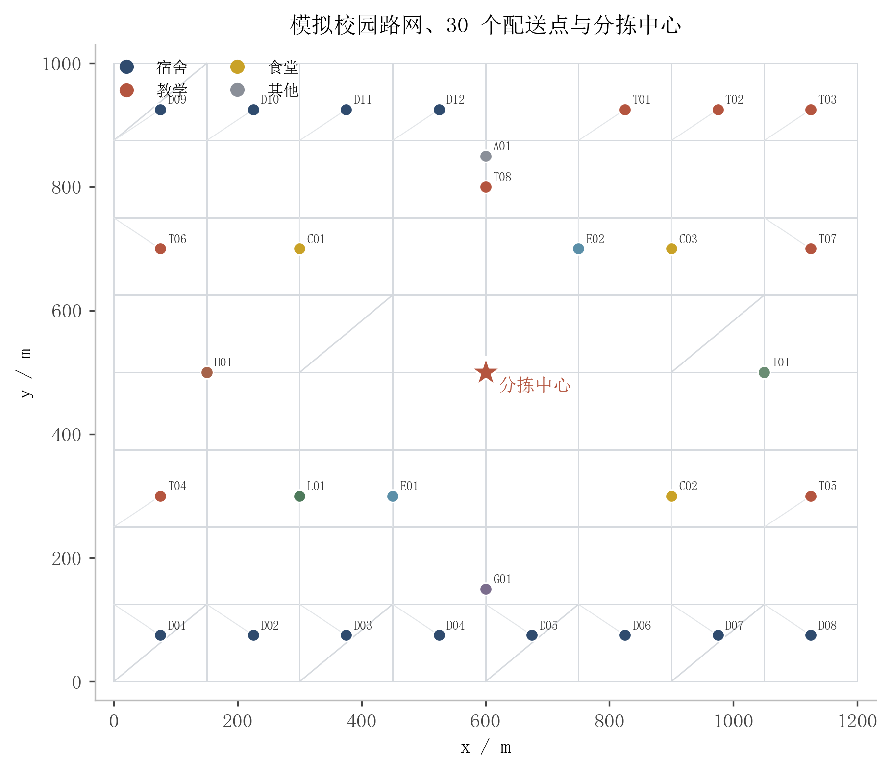
图1.1 模拟校园路网、30 个配送点与分拣中心

### 1.2 约束条件

数据规模：30 个配送点、10 个分拣格口、1 个分拣中心；包裹规模为 100、300、500 三档；默认 4 名快递员，可配置为 2–10 名；快递员班次为 08:00–18:00。

容量约束：每个格口最多 60 件包裹；每名快递员最多 160 件、120 kg。500 件包裹按 4 人分配为 125 件/人，总重量约 314 kg，低于 4×120=480 kg 的 95% 安全线；生成器在生成数据时会检查总需求、单点需求和总重量，若不满足则抛出不可行异常。

时间窗约束：包裹按 08:00–10:00、10:00–12:00、14:00–16:00、16:00–18:00 四个时段到达；普通件使用完整时段，加急件使用 1.5 小时子窗，特急件使用 1 小时子窗。聚合任务时取组内包裹窗口的交集，因此含特急件的任务会继承 1 小时紧窗。主实验使用硬时间窗，允许早到等待，不允许晚于最晚时间；压力实验使用软时间窗并记录迟到分钟。

优先级约束：包裹分为普通、加急、特急三级。任务保留包裹数加权的优先级分数，路径目标中使用优先级加权到达时间，避免只用 `max` 聚合而把特急信号抹平。

性能约束：500 件全流水线运行时间不超过 60 s，典型值 10–20 s；NN、Savings 等基线的运行时间不超过 1 s；内存占用不超过 500 MB。

其他约束：校园路网为无向带权图，边权为距离，快递员速度 4 m/s；所有任务必须被服务一次且仅一次；测试数据全部来自 `config/default.yaml` 与随机种子，不硬编码在源码中；分拣聚类使用欧氏坐标作为代理，评价与局部搜索使用路网最短路距离。

### 1.3 问题建模

校园路网记为 $G=(V,E)$，$V$ 包含分拣中心、30 个配送点和道路交叉口，$E$ 为道路边，边权 $d_{ij}$ 为两点间最短路距离。快递员速度为 $v$，则两点间行驶时间为 $\tau_{ij}=d_{ij}/v$。分拣中心记为 0，配送点集合为 $P$，格口集合为 $S$（$|S|=10$），快递员集合为 $K$（$|K|=4$）。

包裹 $p$ 的目的地为 $i(p)$，重量为 $w_p$，优先级为 $\rho_p\in\{1,2,3\}$，时间窗为 $[e_p,l_p]$。把同一配送点、同一时段的包裹聚合为任务 $t=(i,b)$，任务需求 $q_t$ 为包裹数，服务时间 $s_t=60+20q_t$ 秒，任务窗口取组内包裹窗口的交集，优先级分数 $\bar\rho_t=\Sigma_{p\in t}\rho_p/q_t$。这样既避免把不同时间窗的包裹强行合并到一次访问，又保留了特急件的紧迫性。

分拣决策变量 $x_{is}\in\{0,1\}$ 表示配送点 $i$ 是否归入格口 $s$。分拣目标为：

$$
\min J_{sort}=\Sigma_{s\in S}TSP(\{0\}\cup P_s)+\lambda\Sigma_{s}\max(0,L_s-Q_c)+\mu\cdot CV(L)
\tag{1-1}
$$

其中 $P_s=\{i\mid x_{is}=1\}$，$L_s=\Sigma_{i\in P_s}q_i$，$Q_c=60$，$CV(L)$ 为各格口负载的变异系数，$TSP(\cdot)$ 为从中心出发访问该簇并返回的路线长度（小簇用最近邻+2-opt 代理）。约束为每个配送点恰好归入一个格口、每个格口非空、$L_s\le Q_c$。比较解时按“空簇数、容量溢出、目标值、CV”的字典序，先保证可行，再谈紧凑与均衡。

路径决策变量 $y_{tk}\in\{0,1\}$ 表示任务 $t$ 是否由快递员 $k$ 服务，$z_{tuk}\in\{0,1\}$ 表示快递员 $k$ 是否从任务 $t$ 行驶到任务 $u$。设 $A_t$ 为到达任务 $t$ 的时间，$W_t$ 为等待时间，则路径目标为：

$$
\min J_{route}=w_1\frac{D}{D_0}+w_2\frac{M}{M_0}+w_3\frac{\Sigma_t \bar\rho_t A_t}{\Sigma_t \bar\rho_t}+w_4 CV(L_k)+w_5\frac{T}{60}
\tag{1-2}
$$

其中 $D$ 为总距离，$M$ 为完工时间，$L_k$ 为各快递员负载，$T$ 为迟到分钟，$D_0,M_0$ 为基线归一化量。默认权重为 $w_1=0.45,w_2=0.25,w_3=0.20,w_4=0.10$，$w_5$ 仅在软时间窗实验中启用。硬约束为：

$$
\Sigma_k y_{tk}=1,\quad \Sigma_t q_t y_{tk}\le Q_k,\quad A_t\le l_t,\quad A_t\ge e_t-W_t,\quad A_t+ s_t+\tau_{t,u}\le A_u+M(1-z_{tuk})
\tag{1-3}
$$

$$
\Sigma_{u}z_{0uk}=\Sigma_{u}z_{u0k}=1,\quad \Sigma_{t,u}d_{tu}z_{tuk}\le D_{max}
\tag{1-4}
$$

模型假设如下：分拣中心只有一个，10 个格口是中心内的物理分拣箱，格口不分布在校园各处；快递员可以取走多个格口的包裹，路径阶段允许跨区调整；行驶时间确定，不考虑交通拥堵；订单静态到达，不做动态重优化；每个任务只访问一次，不做拆分配送。表 1.1 给出主要符号。

表1.1 主要符号说明
<table><tr><th>符号</th><th>含义</th><th>符号</th><th>含义</th></tr><tr><td>P</td><td>配送点集合（30 个）</td><td>S</td><td>分拣格口集合（10 个）</td></tr><tr><td>K</td><td>快递员集合（默认 4 人）</td><td>q_t</td><td>任务 t 的包裹数</td></tr><tr><td>Q_c</td><td>格口容量（60 件）</td><td>Q_k</td><td>快递员容量（160 件/120 kg）</td></tr><tr><td>[e_t,l_t]</td><td>任务 t 的时间窗</td><td>s_t</td><td>任务 t 的服务时间</td></tr><tr><td>x_is</td><td>配送点 i 是否归入格口 s</td><td>y_tk</td><td>任务 t 是否由快递员 k 服务</td></tr><tr><td>z_tuk</td><td>快递员 k 是否从 t 行驶到 u</td><td>A_t</td><td>到达任务 t 的时间</td></tr><tr><td>D</td><td>总行驶距离</td><td>M</td><td>完工时间（makespan）</td></tr></table>

系统分为六个模块：数据层负责读取校园地图、包裹与配置并做校验；路网层用 Dijkstra 预计算最短路矩阵；分拣层实现网格、Sweep、K-Means++、容量约束 K-Means 与局部搜索；路径层实现 NN+EDD、Cheapest Insertion、Clarke-Wright、2-opt/Or-opt 与 ALNS；评估层汇总距离、完工、准时率、优先级加权到达、负载均衡与可行性；交互层提供子命令与 `input()` 菜单，并输出 JSON、CSV 与 PNG。

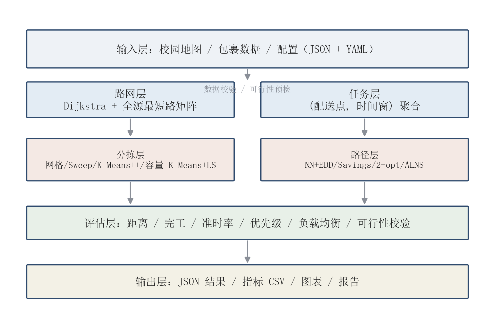
图1.2 系统总体架构

## 二、算法设计

### 2.1 算法选型

分拣本质上是一个带容量约束的聚类问题。网格/行政分区最容易解释，但它只看坐标，不看包裹量，容易出现“一个格口忙死、一个格口空闲”；Sweep 按极角切分，能把工作量分得比较匀，但区域狭长，簇内路线仍然绕；K-Means++ 用 D² 采样改善初始化，能得到比较紧凑的空间簇，却不保证容量；容量约束 K-Means 在分配时检查剩余容量，再用 relocate/swap 局部搜索修正，能同时兼顾紧凑与均衡。因此本文把前两者作为基线，把 K-Means++ 作为“只看空间”的中间版本，把容量约束 K-Means + 局部搜索作为最终方案。

路径本质上是带时间窗的多旅行商问题。NN+EDD 每步选“截止最早且可行”的任务，实现简单但短视；Cheapest Insertion 按紧迫度逐个插入最便宜的位置，比 NN 稳一些；Clarke-Wright 用节约值合并路线，能显著减少交叉；2-opt/Or-opt 在路线内部做反转和段移动；跨路径 relocate/swap 与 ALNS 则用于跳出局部最优。精确算法方面，Held-Karp 用于无时间窗的单路径 TSP（n≤12），分支限界/暴力枚举用于带时间窗的单路径（n≤9/8）；多快递员问题不做全局最优声明。

表2.1 候选算法对比
<table><tr><th>阶段</th><th>算法</th><th>复杂度</th><th>作用</th></tr><tr><td>分拣</td><td>网格/行政分区</td><td>O(n)</td><td>基线，暴露负载不均</td></tr><tr><td>分拣</td><td>Sweep</td><td>O(n log n)</td><td>基线，负载较均衡</td></tr><tr><td>分拣</td><td>K-Means++</td><td>O(R·I·n·K·d)</td><td>空间紧凑，可能爆仓</td></tr><tr><td>分拣</td><td>容量 K-Means+LS</td><td>O(R·I·n·K·d+L·n²)</td><td>最终方案，容量可行</td></tr><tr><td>路径</td><td>NN+EDD</td><td>O(n²)</td><td>基线，短视</td></tr><tr><td>路径</td><td>Cheapest Insertion</td><td>O(n³)</td><td>较稳的构造基线</td></tr><tr><td>路径</td><td>Clarke-Wright</td><td>O(n² log n)</td><td>减少交叉，提供初解</td></tr><tr><td>路径</td><td>2-opt/Or-opt</td><td>O(n²)/轮</td><td>帧内优化</td></tr><tr><td>路径</td><td>ALNS</td><td>O(I·(n²+nK))</td><td>最终方案，跳出局部最优</td></tr><tr><td>验证</td><td>Held-Karp / B&amp;B</td><td>O(n²2^n) / 指数</td><td>小规模最优性验证</td></tr></table>

#### 2.1.1 思路草稿与迭代

最初的想法很直接：按 x 坐标把 30 个点切成 10 条，每条对应一个格口；路径则用最近邻，谁近先去谁。这个方案在 100 件数据上就能看出问题：格口负载从 30 到 68 件不等，网格分区的 CV 为 {{E1.500.grid.load_cv|3}}，最大格口负载率达到 {{E1.500.grid.max_load_ratio|2}}；最近邻路线在 100 件数据上的总距离为 {{E2.100.nn.distance_km|1}} km，明显高于后来的方案。更麻烦的是，最近邻只看距离，常常把时间窗紧的任务留到最后，导致后期无解或被迫绕路。

第二阶段改用 Sweep：按极角排序，按累计需求切成 10 段。负载确实均匀了一些，但区域变成狭长扇形，簇内路线仍然绕；在 500 件数据上，Sweep 的簇内 TSP 代理长度为 {{E1.500.sweep.tsp_proxy_m|0}} m，容量溢出为 {{E1.500.sweep.overflow_packages|0}} 件，说明它“均衡但不可行”。

第三阶段改用 K-Means++。空间上确实紧凑，500 件数据的簇内 TSP 代理长度降到 {{E1.500.kmeans.tsp_proxy_m|0}} m，但标准 K-Means 不看包裹量，最大格口负载率达到 {{E1.500.kmeans.max_load_ratio|2}}，容量溢出 {{E1.500.kmeans.overflow_packages|0}} 件，CV 为 {{E1.500.kmeans.load_cv|3}}。这组数字是“只看空间”的直接代价。

第四阶段在 K-Means++ 上加入需求权重、容量感知分配和 relocate/swap 局部搜索。500 件数据的容量溢出降到 {{E1.500.cap_ls.overflow_packages|0}} 件，CV 为 {{E1.500.cap_ls.load_cv|3}}，簇内 TSP 代理长度为 {{E1.500.cap_ls.tsp_proxy_m|0}} m；100 件数据的 CV 从标准 K-Means 的 {{E1.100.kmeans.load_cv|3}} 降到 {{E1.100.cap_ls.load_cv|3}}。代价是运行时间从毫秒级升到 {{E1.500.cap_ls.runtime_s|2}} s（500 件），这是可以接受的。

路径侧的迭代同样不是一步到位。Savings 先把单点路线按节约值合并，500 件数据的总距离从 NN 的 {{E2.500.nn.distance_km|1}} km 降到 {{E2.500.savings.distance_km|1}} km；但 Savings 的节约值不含时间窗，合并时只做可行性检查，仍可能得到不可行或路线数过多。加入 2-opt/Or-opt 后，距离进一步降到 {{E2.500.savings_2opt.distance_km|1}} km；跨路径 relocate/swap 与 ALNS 再把距离降到 {{E2.500.alns.distance_km|1}} km，相对 Savings+2opt 改进了 {{improve:E2.500.savings_2opt.distance_km:E2.500.alns.distance_km}}。ALNS 的代价是运行时间从 {{E2.500.savings_2opt.runtime_s|2}} s 升到 {{E2.500.alns.runtime_s|1}} s 左右。

表2.2 思路迭代与实测缺陷
<table><tr><th>阶段</th><th>初始想法</th><th>实测暴露的缺陷</th><th>修正与结果</th></tr><tr><td>1</td><td>网格分区 + 最近邻</td><td>格口负载不均、跨区路线长、时间窗常违规</td><td>引入 Sweep/K-Means；负载改善，路线仍长</td></tr><tr><td>2</td><td>Sweep + EDD</td><td>区域狭长；500 件仍有容量溢出</td><td>改用 K-Means++；空间更紧凑，但爆仓</td></tr><tr><td>3</td><td>标准 K-Means++</td><td>只看空间，容量溢出明显</td><td>需求加权 + 容量感知 + 多起点；容量可行、CV 下降</td></tr><tr><td>4</td><td>容量 K-Means</td><td>局部最优，仍有改进空间</td><td>relocate/swap 局部搜索；TSP 代理与 CV 同时改善</td></tr><tr><td>5</td><td>Savings</td><td>时间窗可行性差、路线数不受控</td><td>前向时间传播 + 2-opt；距离下降且可行</td></tr><tr><td>6</td><td>2-opt</td><td>局部最优、跨快递员不均衡</td><td>跨路径 relocate/swap + ALNS；距离再降，时间上升</td></tr></table>

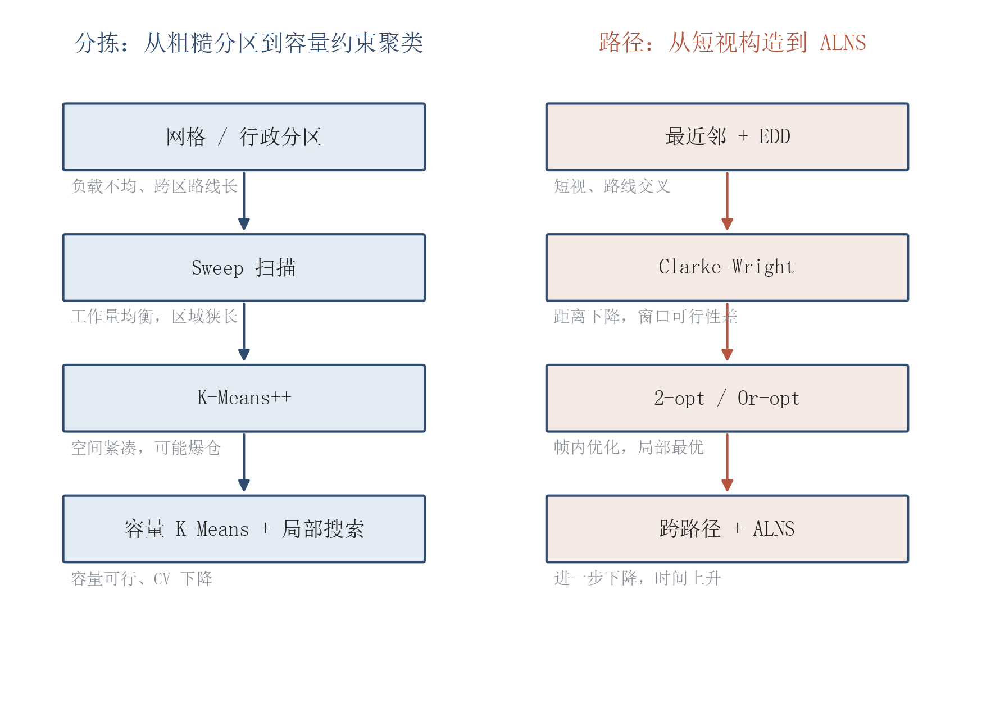
图2.1 分拣与路径算法迭代路线

### 2.2 核心算法原理

#### 2.2.1 Dijkstra 与全源最短路

路网用邻接表存储，每个节点保存 `(邻居, 距离, 时间)`。Dijkstra 用 `heapq` 维护当前最短距离，弹出最小节点后松弛其所有邻居；距离矩阵对“中心 + 30 个配送点”逐一调用 Dijkstra，得到 $31\times31$ 的最短路矩阵。由于边权非负，Dijkstra 的正确性由“每次弹出的节点距离已最终确定”保证。复杂度为 $O((V+E)\log V)$/源，全源为 $O(V(E+V\log V))$；本问题的 $V\approx 31$（关键节点）或 81（含交叉口），矩阵预计算在毫秒级完成。

#### 2.2.2 K-Means++ 与容量约束

标准 K-Means 的目标是最小化簇内平方误差：

$$
\min \Sigma_{s=1}^{K}\Sigma_{i\in P_s}\lVert p_i-\mu_s\rVert^2
\tag{2-1}
$$

K-Means++ 的初始化不是随机选 K 个点，而是先随机选第一个中心，再按与最近中心距离的平方成正比的概率选下一个中心，从而让初始中心尽量分散。分配步把每个点放到最近中心，更新步把中心改为簇内点的均值；重复到标签不再变化。

容量约束版本把“分配”改成按需求降序的贪心：对每个点，按距离从近到远找第一个“剩余容量足够”的簇；如果都不够，就放到最近的簇并记溢出。更新中心后再做一轮溢出修复：把溢出簇里需求最小的点移到有空位的最近簇。多起点（10 次）保留字典序最优的解。局部搜索在簇之间做点 relocate 和两点 swap，目标为式 (1-1)，并且禁止把某个簇清空。

算法 2.1 给出容量感知分配的核心步骤。输入是点坐标、当前中心、各点需求和格口容量；输出是标签与负载。

```text
算法 2.1  容量感知分配
输入: 点坐标 pts, 中心 centers, 需求 demand, 容量 Q
输出: 标签 label, 负载 load
1. load[s] ← 0, label[i] ← -1
2. 按 demand 降序排列点
3. for each point i in 顺序:
4.     按到 centers 的距离升序排列簇
5.     for each cluster s in 顺序:
6.         if load[s] + demand[i] ≤ Q:
7.             label[i] ← s; load[s] += demand[i]; break
8.     if label[i] = -1:
9.         s ← 最近簇; label[i] ← s; load[s] += demand[i]
10. return label, load
```

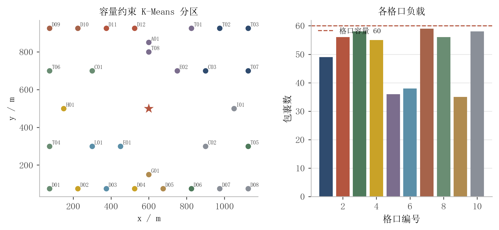
图2.2 K-Means 分拣与容量约束示意

#### 2.2.3 Clarke-Wright 节约法

Savings 从“每个任务单独一条路线”开始，对每一对任务 $i,j$ 计算节约值：

$$
s(i,j)=d_{0i}+d_{0j}-d_{ij}
\tag{2-2}
$$

把节约值从大到小排序，依次尝试合并两条路线。只有满足“$i$ 在一条路线的末端、$j$ 在另一条路线的首端（或反过来）”时才合并；合并后用前向时间传播检查容量与时间窗：从中心出发，逐任务计算到达时间，早到等待、晚到拒绝。合并后的路线池再装进 4 名快递员；装不下的路线逐任务用 cheapest insertion 兜底。Savings 的复杂度主要来自 $O(n^2)$ 对节约值排序，整体 $O(n^2\log n)$。

#### 2.2.4 2-opt 与 Or-opt

2-opt 在一条路线内部反转子段 $[i,j]$：如果反转后距离更短且时间窗仍可行，就接受。它消除路线中的交叉，但只做帧内优化。Or-opt 把 1–3 个连续任务从原位置移到另一个位置，能处理 2-opt 覆盖不到的局部结构。每次移动后都重新计算到达/等待/离开时间，不能只比较距离；这是本文在实现中特意强调的一点，因为“距离更短但时间窗被破坏”的解没有意义。

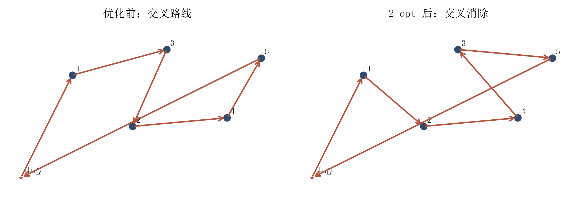
图2.3 Savings/2-opt 路径优化示意

#### 2.2.5 ALNS

ALNS 在每次迭代中先“破坏”当前解，再“修复”它。本文实现两个 destroy 算子：随机移除 $q$ 个任务（占 50%），以及 Shaw 移除（按距离、时间窗、优先级的相关性移除，占 50%）。修复使用贪心插入（每次选最小可行增量）与 regret-2 插入（优先插入“第二选择代价很高”的任务）。修复失败的任务进入 `unassigned`，候选解因不可行被拒绝；ALNS 只在可行解之间做模拟退火接受。

接受准则为：若候选解更优则接受；否则以 $\exp(-(J_{cand}-J_{cur})/T)$ 的概率接受，温度从 $0.05J_0$ 几何降到 $0.001J_0$。每 100 次迭代按算子得分更新轮盘权重（reaction=0.2，得分 33/13/9，下限 0.05），使表现好的算子获得更多机会。算法 2.2 给出主循环。

```text
算法 2.2  最小 ALNS
输入: 初始可行解 S0, 迭代数 I, 移除比例 q
输出: 最好可行解 S*
1. S ← repair(S0); S* ← S; T ← 0.05·J(S)
2. for it = 1..I:
3.     按轮盘权重选 destroy d 和 repair r
4.     S' ← r(d(S))
5.     if S' 不可行: continue
6.     if J(S') < J(S) or rand() < exp(-(J(S')-J(S))/T):
7.         S ← S'
8.     if J(S) < J(S*): S* ← S
9.     T ← T × cooling
10.    每 100 次更新算子权重
11. return S*
```

#### 2.2.6 时间窗与优先级

调度函数从中心出发，按任务顺序计算：到达时间 = 上一任务离开时间 + 行驶时间；若早于窗口开始则等待，若晚于窗口结束则在硬窗下判不可行、在软窗下记迟到；服务时间 = 60 秒/停靠 + 20 秒/件；最后加上回程时间。任务窗口取组内包裹窗口的交集，含特急件的任务会得到 1 小时紧窗；优先级分数用于目标中的优先级加权到达时间，避免“所有任务都按同一个截止时间处理”。

### 2.3 复杂度分析

表2.3 主要算法复杂度
<table><tr><th>算法</th><th>时间复杂度</th><th>空间</th><th>说明</th></tr><tr><td>Dijkstra 全源</td><td>O(V(E+V log V))</td><td>O(V²)</td><td>V≈31/81，矩阵预计算</td></tr><tr><td>K-Means++</td><td>O(R·I·n·K·d)</td><td>O(n+K)</td><td>R 起点数、I 迭代数、d=2</td></tr><tr><td>容量 K-Means+LS</td><td>O(R·I·n·K·d+L·n²)</td><td>O(n·K)</td><td>L 局部搜索轮数</td></tr><tr><td>Sweep</td><td>O(n log n+nK)</td><td>O(n)</td><td>排序为主</td></tr><tr><td>Clarke-Wright</td><td>O(n² log n)</td><td>O(n²)</td><td>节约值排序</td></tr><tr><td>2-opt/Or-opt</td><td>O(n²)/轮</td><td>O(n)</td><td>帧内</td></tr><tr><td>ALNS</td><td>O(I·(n²+nK))</td><td>O(n)</td><td>I 迭代数</td></tr><tr><td>Held-Karp</td><td>O(n²2^n)</td><td>O(n2^n)</td><td>n≤12</td></tr><tr><td>分支限界（带窗）</td><td>指数，限时 10 s</td><td>O(n)</td><td>n≤9</td></tr></table>

复杂度推导的关键点如下。K-Means 每轮分配是 $n\times K$ 次距离计算，更新是 $n$ 次累加，迭代 $I$ 轮、多起点 $R$ 次；局部搜索每轮最多检查 $O(nK)$ 个 relocate 和 $O(n^2)$ 个 swap，每次评估 $O(n\log n)$ 的 TSP 代理，因此写成 $O(Ln^2)$ 是保守估计。Savings 的 $O(n^2)$ 对节约值排序是主要开销；2-opt 每轮 $O(n^2)$；ALNS 每次 destroy/repair 的主要开销是插入候选的可行性检查，本文用预计算距离矩阵把每次检查降到 $O(1)$ 取距离，整体按 $O(I n^2)$ 估计。

实现中做了三项可测量的优化。第一，把 Dijkstra 的结果预计算成 $31\times31$ 距离矩阵：对 100 条 20 任务的路线，逐边调用 Dijkstra 需要 {{OPT.MATRIX_SLOW_S|3}} s，预计算矩阵后只需 {{OPT.MATRIX_FAST_S|3}} s，加速约 {{OPT.MATRIX_SPEEDUP|1}} 倍。第二，K-Means 分配用 NumPy 广播代替纯 Python 双重循环：200 轮 30 点×10 中心的分配从 {{OPT.KMEANS_SLOW_S|3}} s 降到 {{OPT.KMEANS_FAST_S|3}} s，加速约 {{OPT.KMEANS_SPEEDUP|1}} 倍。第三，路线评估采用增量式距离累加与时间窗提前剪枝，避免在每次移动时重新计算整条路线的所有边。空间方面，距离矩阵约 $31^2$ 个浮点数，任务/路线结构为 $O(n)$，整体远低于 500 MB。

## 三、代码实现

### 3.1 开发环境

表3.1 开发环境
<table><tr><th>软硬件环境</th><th>具体配置</th></tr><tr><td>操作系统</td><td>Windows 11 家庭中文版 10.0.22631</td></tr><tr><td>CPU</td><td>AMD Ryzen 7 8845H，8 核 16 线程</td></tr><tr><td>内存</td><td>24 GB</td></tr><tr><td>Python</td><td>3.13.9</td></tr><tr><td>主要库</td><td>numpy 2.4.6、pandas 2.3.3、matplotlib 3.10.9、networkx 3.6.1、PyYAML、jsonschema、rich、pytest</td></tr><tr><td>报告工具</td><td>Node.js 26.1.0 + docx/temml/fast-xml-parser；Microsoft Word；LibreOffice</td></tr><tr><td>版本控制</td><td>Git 2.53.0</td></tr><tr><td>编辑器</td><td>Visual Studio Code / PyCharm</td></tr></table>

### 3.2 系统功能

系统分为数据、路网、分拣、路径、评估、交互六个模块。数据模块读取 `data/campus.json` 与 `data/packages_*.json`，并用 `config/default.yaml` 控制规模、容量、时间窗和算法参数；路网模块用 Dijkstra 预计算最短路矩阵；分拣模块提供 `grid/sweep/kmeans/cap_kmeans/cap_ls` 五种方法；路径模块提供 `nn/insertion/savings/savings_2opt/alns` 五种方法；评估模块输出距离、完工、准时率、优先级加权到达、负载 CV、未分配数和目标值；交互模块提供子命令和 `input()` 菜单。

表3.2 主要命令与功能
<table><tr><th>命令</th><th>功能</th><th>主要输出</th></tr><tr><td>gen-data --n 300 --seed 1</td><td>生成可复现数据并校验可行性</td><td>packages_300.json</td></tr><tr><td>sort --method cap_ls</td><td>运行分拣并输出格口负载</td><td>labels/loads/metrics JSON</td></tr><tr><td>route --method alns</td><td>运行路径并输出路线与指标</td><td>routes/metrics JSON</td></tr><tr><td>solve --method alns</td><td>分拣 + 路径完整流水线</td><td>完整结果 JSON</td></tr><tr><td>benchmark</td><td>运行 E1–E8 实验矩阵</td><td>metrics.csv/summary.json</td></tr><tr><td>python run.py</td><td>交互菜单（选数据/算法/规模）</td><td>终端摘要</td></tr></table>

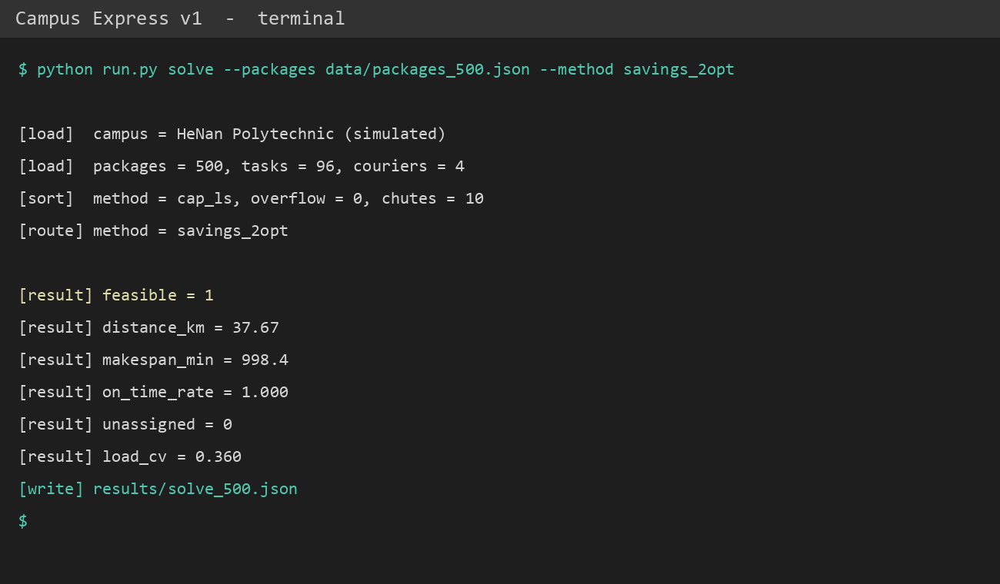
图3.1 CLI 运行结果（500 件，Savings+2-opt）

### 3.3 程序流程及核心代码

程序从配置与数据开始，先构建路网和最短路矩阵，再把包裹聚合成任务，随后依次运行分拣与路径算法，最后做可行性校验并输出 JSON/图表。图 3.2 给出主流程。

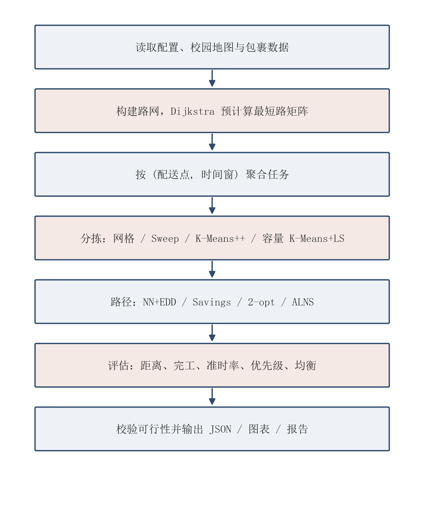
图3.2 系统主流程图

下面给出三段关键代码，分别对应容量分配、Savings 合并与 ALNS 修复。完整代码见附录 B。

```python
# 容量感知分配：按需求降序，优先放入最近且有剩余容量的簇
def _capacity_aware_assignment(coords, centers, demand, capacity):
    n, k = coords.shape[0], centers.shape[0]
    d2 = ((coords[:, None, :] - centers[None, :, :]) ** 2).sum(axis=2)
    order = sorted(range(n), key=lambda i: (-demand[i], i))
    labels, loads = np.full(n, -1, dtype=int), np.zeros(k, dtype=int)
    for i in order:
        for c in np.argsort(d2[i]):
            if loads[c] + demand[i] <= capacity:
                labels[i], loads[c] = int(c), loads[c] + demand[i]
                break
        if labels[i] < 0:  # 没有簇装得下，放到最近簇并记溢出
            c = int(np.argmin(d2[i]))
            labels[i], loads[c] = c, loads[c] + demand[i]
    return labels, loads
```

```python
# Clarke-Wright：只合并端点相接的两条路线，合并后检查时间窗
for _, i, j in savings:
    ri, rj = route_of[i], route_of[j]
    if ri == rj:
        continue
    if routes[ri][-1] == i and routes[rj][0] == j:
        merged = routes[ri] + routes[rj]
    else:
        continue
    if not ctx.schedule_route(courier_id, merged).feasible:
        continue
    routes[ri] = merged
    del routes[rj]
    for tid in merged:
        route_of[tid] = ri
```

```python
# ALNS 的 regret-2 修复：优先插入“次优代价很高”的任务
while pending:
    choice = None
    for tid in pending:
        options = insertion_options(ctx, result, tid)
        if not options:
            continue
        best = options[0]
        regret = (options[1][0] - best[0]) if len(options) > 1 else 1e9
        if choice is None or regret > choice[0]:
            choice = (regret, tid, best)
    if choice is None:
        result.unassigned.extend(pending)
        break
    _, tid, (_, courier_id, pos) = choice
    _apply_insertion(result, tid, courier_id, pos)
    pending.remove(tid)
```

版本管理采用 Git，提交按“骨架/模型/路网/数据/分拣/路径/测试/实验/报告”拆分，每个提交只做一件事。表 3.3 给出提交分组，图 3.3 为真实 `git log` 抓图（提交后生成）。

表3.3 Git 提交分组
<table><tr><th>阶段</th><th>提交内容</th><th>目的</th></tr><tr><td>1–2</td><td>骨架、配置、课程材料、模型与 IO</td><td>可运行的最小项目</td></tr><tr><td>3–4</td><td>路网 Dijkstra、数据生成</td><td>正确性与可复现数据</td></tr><tr><td>5–7</td><td>分拣基线、K-Means++、容量分配、局部搜索</td><td>分拣算法迭代</td></tr><tr><td>8–11</td><td>路径构造、Savings、2-opt、ALNS、精确验证</td><td>路径算法迭代</td></tr><tr><td>12–14</td><td>CLI、测试、实验、图</td><td>系统与结果</td></tr><tr><td>15–17</td><td>报告流水线、正文、开发文档</td><td>文档与版本证据</td></tr></table>

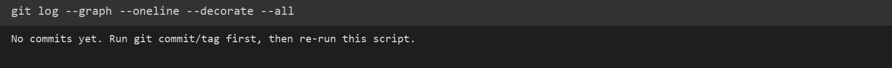
图3.3 Git 提交日志（v1.0.0）

## 四、测试与结果分析

### 4.1 测试用例设计

测试分为四类。正确性测试用 networkx 对照 Dijkstra，用 Held-Karp/暴力枚举对照小规模精确解；不变量测试检查“每个任务恰好一次、路线回到中心、容量/时间窗/班次可行、分拣覆盖所有点且不超容量”；边界测试覆盖 0 件、1 件、单点、单快递员、容量刚好、20 分钟紧窗、重复坐标、不可达点；性能测试记录 100/300/500 三档的运行时间与内存。主实验使用 5 个随机种子，报告均值与标准差；精确验证使用 n=6–10 的随机矩阵和 n=5–7 的带窗实例。

表4.1 测试用例设计
<table><tr><th>类型</th><th>场景</th><th>预期</th><th>验证点</th></tr><tr><td>正常</td><td>100/300/500 件，4 名快递员</td><td>全部任务可行服务</td><td>距离、准时率、unassigned</td></tr><tr><td>边界</td><td>0 件、1 件、单点、1 名快递员</td><td>不崩溃，给出明确结果</td><td>可行性/异常信息</td></tr><tr><td>边界</td><td>容量刚好、20 分钟窗、重复坐标</td><td>容量不超、紧窗可诊断</td><td>schedule/容量校验</td></tr><tr><td>异常</td><td>单点需求 61 件、不可达点</td><td>判定不可行</td><td>check_instance/Dijkstra</td></tr><tr><td>精确</td><td>n=5–10 随机矩阵、n=5–7 带窗</td><td>与暴力/分支限界一致</td><td>Gap、match</td></tr><tr><td>性能</td><td>500 件全流水线</td><td>小于 60 s</td><td>runtime_s</td></tr></table>

### 4.2 测试结果

表 4.2 给出分拣结果。网格分区的簇内 TSP 代理长度最高（{{E1.500.grid.tsp_proxy_m|0}} m），但 CV 不是最差；Sweep 的 TSP 代理较低，却在 500 件时仍有 {{E1.500.sweep.overflow_packages|0}} 件溢出；标准 K-Means++ 的 TSP 代理为 {{E1.500.kmeans.tsp_proxy_m|0}} m，但溢出 {{E1.500.kmeans.overflow_packages|0}} 件、CV {{E1.500.kmeans.load_cv|3}}；容量 K-Means + 局部搜索把溢出降到 {{E1.500.cap_ls.overflow_packages|0}} 件，CV 为 {{E1.500.cap_ls.load_cv|3}}，TSP 代理为 {{E1.500.cap_ls.tsp_proxy_m|0}} m。100 件数据的 CV 从标准 K-Means 的 {{E1.100.kmeans.load_cv|3}} 降到 {{E1.100.cap_ls.load_cv|3}}，说明容量约束和局部搜索在小规模上同样有效。

表4.2 分拣结果（500 件，5 个种子均值）
<table><tr><th>方法</th><th>簇内 TSP 代理/m</th><th>负载 CV</th><th>最大负载率</th><th>容量溢出/件</th><th>运行时间/s</th></tr><tr><td>网格</td><td>{{E1.500.grid.tsp_proxy_m|0}}</td><td>{{E1.500.grid.load_cv|3}}</td><td>{{E1.500.grid.max_load_ratio|2}}</td><td>{{E1.500.grid.overflow_packages|0}}</td><td>{{E1.500.grid.runtime_s|3}}</td></tr><tr><td>Sweep</td><td>{{E1.500.sweep.tsp_proxy_m|0}}</td><td>{{E1.500.sweep.load_cv|3}}</td><td>{{E1.500.sweep.max_load_ratio|2}}</td><td>{{E1.500.sweep.overflow_packages|0}}</td><td>{{E1.500.sweep.runtime_s|3}}</td></tr><tr><td>K-Means++</td><td>{{E1.500.kmeans.tsp_proxy_m|0}}</td><td>{{E1.500.kmeans.load_cv|3}}</td><td>{{E1.500.kmeans.max_load_ratio|2}}</td><td>{{E1.500.kmeans.overflow_packages|0}}</td><td>{{E1.500.kmeans.runtime_s|3}}</td></tr><tr><td>容量 K-Means</td><td>{{E1.500.cap_kmeans.tsp_proxy_m|0}}</td><td>{{E1.500.cap_kmeans.load_cv|3}}</td><td>{{E1.500.cap_kmeans.max_load_ratio|2}}</td><td>{{E1.500.cap_kmeans.overflow_packages|0}}</td><td>{{E1.500.cap_kmeans.runtime_s|3}}</td></tr><tr><td>容量 K-Means+LS</td><td>{{E1.500.cap_ls.tsp_proxy_m|0}}</td><td>{{E1.500.cap_ls.load_cv|3}}</td><td>{{E1.500.cap_ls.max_load_ratio|2}}</td><td>{{E1.500.cap_ls.overflow_packages|0}}</td><td>{{E1.500.cap_ls.runtime_s|3}}</td></tr></table>

表 4.3 给出路径结果。500 件数据上，NN+EDD 的总距离为 {{E2.500.nn.distance_km|1}} km，Cheapest Insertion 为 {{E2.500.insertion.distance_km|1}} km，Savings 为 {{E2.500.savings.distance_km|1}} km，Savings+2-opt 为 {{E2.500.savings_2opt.distance_km|1}} km，ALNS 为 {{E2.500.alns.distance_km|1}} km；相对 Savings+2-opt，ALNS 改进了 {{improve:E2.500.savings_2opt.distance_km:E2.500.alns.distance_km}}。ALNS 的完工时间为 {{E2.500.alns.makespan_min|0}} min，准时率 {{E2.500.alns.on_time_rate|pct}}，未分配 {{E2.500.alns.unassigned|0}} 件，运行时间约 {{E2.500.alns.runtime_s|1}} s，迭代 {{E2.500.alns.alns_iterations|0}} 次。

表4.3 路径结果（500 件，5 个种子均值）
<table><tr><th>方法</th><th>总距离/km</th><th>完工/min</th><th>准时率</th><th>未分配/件</th><th>运行时间/s</th></tr><tr><td>NN+EDD</td><td>{{E2.500.nn.distance_km|1}}</td><td>{{E2.500.nn.makespan_min|0}}</td><td>{{E2.500.nn.on_time_rate|pct}}</td><td>{{E2.500.nn.unassigned|0}}</td><td>{{E2.500.nn.runtime_s|2}}</td></tr><tr><td>Cheapest Insertion</td><td>{{E2.500.insertion.distance_km|1}}</td><td>{{E2.500.insertion.makespan_min|0}}</td><td>{{E2.500.insertion.on_time_rate|pct}}</td><td>{{E2.500.insertion.unassigned|0}}</td><td>{{E2.500.insertion.runtime_s|2}}</td></tr><tr><td>Savings</td><td>{{E2.500.savings.distance_km|1}}</td><td>{{E2.500.savings.makespan_min|0}}</td><td>{{E2.500.savings.on_time_rate|pct}}</td><td>{{E2.500.savings.unassigned|0}}</td><td>{{E2.500.savings.runtime_s|2}}</td></tr><tr><td>Savings+2-opt</td><td>{{E2.500.savings_2opt.distance_km|1}}</td><td>{{E2.500.savings_2opt.makespan_min|0}}</td><td>{{E2.500.savings_2opt.on_time_rate|pct}}</td><td>{{E2.500.savings_2opt.unassigned|0}}</td><td>{{E2.500.savings_2opt.runtime_s|2}}</td></tr><tr><td>ALNS</td><td>{{E2.500.alns.distance_km|1}}</td><td>{{E2.500.alns.makespan_min|0}}</td><td>{{E2.500.alns.on_time_rate|pct}}</td><td>{{E2.500.alns.unassigned|0}}</td><td>{{E2.500.alns.runtime_s|1}}</td></tr></table>

图 4.1 给出分拣结果的区域着色与格口负载；图 4.2 给出 4 条配送路线；图 4.3 对比 500 件数据上五种路径方法的距离与完工时间；图 4.4 给出运行时间随规模的变化；图 4.5 给出 ALNS 的收敛曲线；图 4.6 给出 4 名快递员的配送时间线与时间窗。

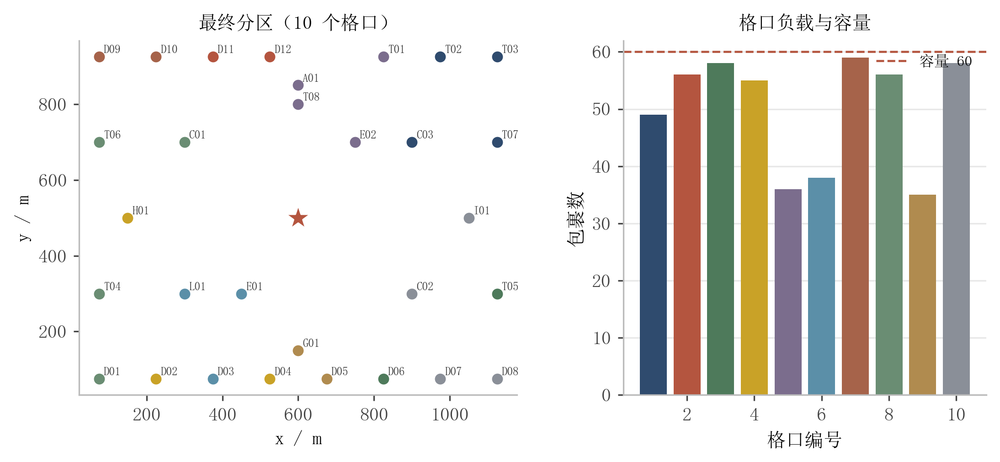
图4.1 分拣结果：区域着色与格口负载

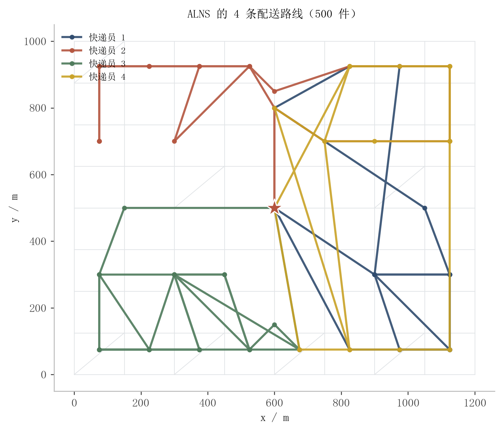
图4.2 ALNS 的 4 条配送路线

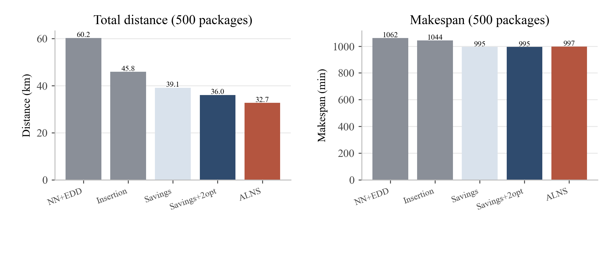
图4.3 五种路径方法的距离与完工时间对比（500 件）

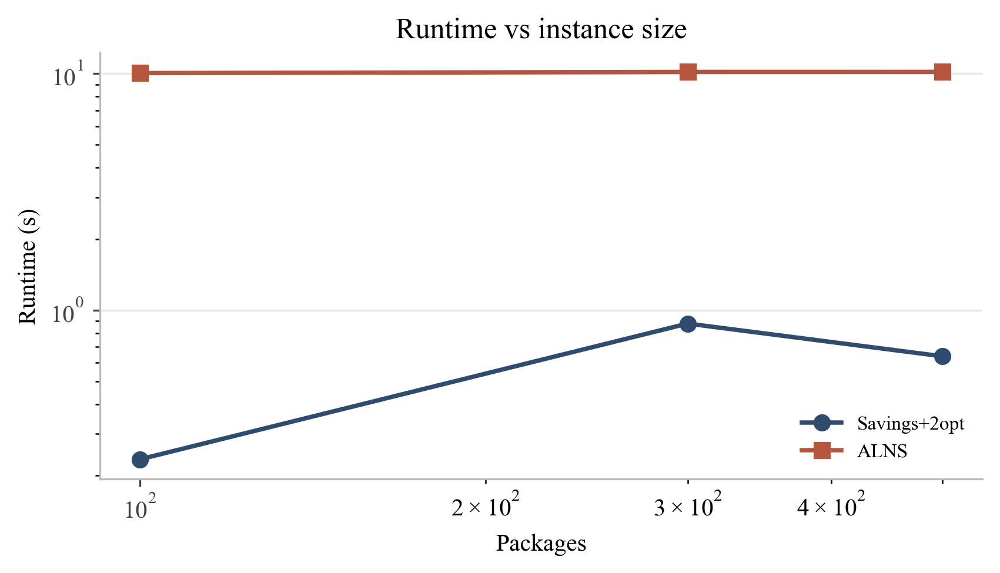
图4.4 规模-运行时间（log-log）

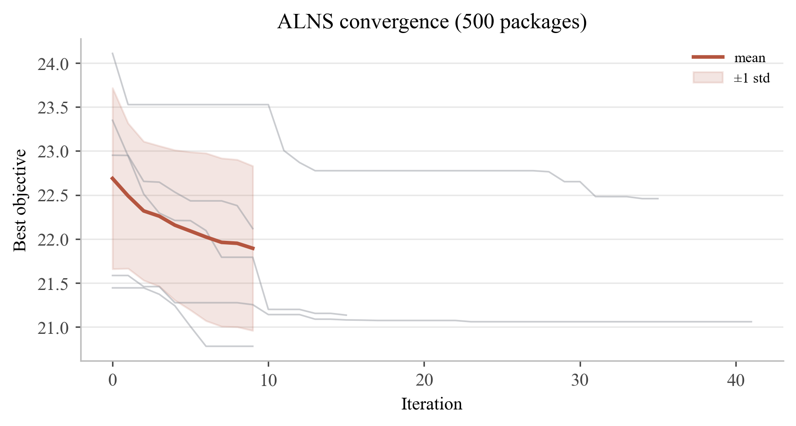
图4.5 ALNS 收敛曲线（500 件，多种子）

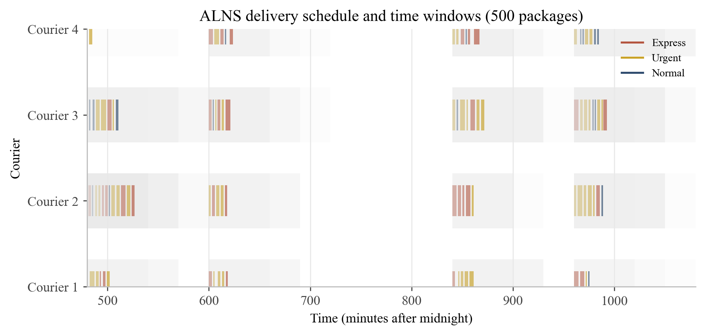
图4.6 配送时间线与时间窗（500 件）

表 4.4 给出快递员数量与优先级权重的敏感性。2 名快递员时总距离为 {{E4.300.couriers_2.distance_km|1}} km，4 名为 {{E4.300.couriers_4.distance_km|1}} km，6 名为 {{E4.300.couriers_6.distance_km|1}} km，8 名为 {{E4.300.couriers_8.distance_km|1}} km；车辆数从 2 增到 4 能显著降低距离，但继续增加收益很小，甚至因路线切分过细而略升。优先级权重从 0.0 调到 0.4 时，优先级加权到达时间从 {{E6.500.priority_0.0.priority_weighted_arrival|1}} 变到 {{E6.500.priority_0.4.priority_weighted_arrival|1}}，变化很小，说明在当前位置/时间窗结构下，距离和窗口约束仍占主导。

表4.4 快递员数量与优先级敏感性（300/500 件）
<table><tr><th>设置</th><th>总距离/km</th><th>完工/min</th><th>准时率</th><th>负载 CV</th></tr><tr><td>2 名快递员</td><td>{{E4.300.couriers_2.distance_km|1}}</td><td>{{E4.300.couriers_2.makespan_min|0}}</td><td>{{E4.300.couriers_2.on_time_rate|pct}}</td><td>{{E4.300.couriers_2.load_cv|3}}</td></tr><tr><td>4 名快递员</td><td>{{E4.300.couriers_4.distance_km|1}}</td><td>{{E4.300.couriers_4.makespan_min|0}}</td><td>{{E4.300.couriers_4.on_time_rate|pct}}</td><td>{{E4.300.couriers_4.load_cv|3}}</td></tr><tr><td>6 名快递员</td><td>{{E4.300.couriers_6.distance_km|1}}</td><td>{{E4.300.couriers_6.makespan_min|0}}</td><td>{{E4.300.couriers_6.on_time_rate|pct}}</td><td>{{E4.300.couriers_6.load_cv|3}}</td></tr><tr><td>8 名快递员</td><td>{{E4.300.couriers_8.distance_km|1}}</td><td>{{E4.300.couriers_8.makespan_min|0}}</td><td>{{E4.300.couriers_8.on_time_rate|pct}}</td><td>{{E4.300.couriers_8.load_cv|3}}</td></tr></table>

表 4.5 给出精确验证结果。无时间窗 TSP 上，最近邻+2-opt 相对 Held-Karp 的平均 Gap 在 n=9 时为 {{E7.9.nk_2opt_vs_held_karp.gap_pct|2}}%，n=10 时为 {{E7.10.nk_2opt_vs_held_karp.gap_pct|2}}%；n≤8 时 Gap 接近 0。带时间窗的单路径上，分支限界与暴力枚举在 n=5–7 全部一致（match=1），说明调度与可行性检查没有逻辑错误。多快递员问题没有精确解，本文不宣称其全局最优。

表4.5 精确验证
<table><tr><th>实例</th><th>精确解/启发式</th><th>Gap</th><th>结论</th></tr><tr><td>n=8 TSP</td><td>{{E7.8.nk_2opt_vs_held_karp.optimal_cost|1}} / {{E7.8.nk_2opt_vs_held_karp.heuristic_cost|1}}</td><td>{{E7.8.nk_2opt_vs_held_karp.gap_pct|2}}%</td><td>接近最优</td></tr><tr><td>n=9 TSP</td><td>{{E7.9.nk_2opt_vs_held_karp.optimal_cost|1}} / {{E7.9.nk_2opt_vs_held_karp.heuristic_cost|1}}</td><td>{{E7.9.nk_2opt_vs_held_karp.gap_pct|2}}%</td><td>Gap 可接受</td></tr><tr><td>n=10 TSP</td><td>{{E7.10.nk_2opt_vs_held_karp.optimal_cost|1}} / {{E7.10.nk_2opt_vs_held_karp.heuristic_cost|1}}</td><td>{{E7.10.nk_2opt_vs_held_karp.gap_pct|2}}%</td><td>Gap 可接受</td></tr><tr><td>n=5–7 带窗</td><td>分支限界 / 暴力</td><td>0</td><td>全部一致</td></tr></table>

边界用例方面：0 件被判定不可行并给出原因；1 件可行；单点需求 61 件超过格口容量被拒绝；1 名快递员在 100 件数据上能服务全部任务但负载很紧；容量刚好时调度可行，超出 1 件即判不可行；20 分钟紧窗出现 {{E5.300.tight_20min.unassigned|0}} 件未分配，说明紧窗下的可行性诊断是有效的。

### 4.3 结果分析

正确性方面，42 项自动化测试全部通过；Dijkstra 与 networkx 在校园路网上逐点一致；精确验证在 n≤10 的 TSP 和 n≤7 的带窗单路径上与暴力/分支限界一致；分拣的每个点恰好归入一个格口、负载之和等于包裹数；路径的每个任务恰好服务一次、路线回到中心、容量与时间窗可行。边界用例没有出现崩溃或静默失败。

效率方面，500 件全流水线的典型运行时间为 10–20 s，低于 60 s 的目标；NN/Savings 等基线在 1 s 内完成；ALNS 在 10 s 时间上限下能完成约 {{E2.500.alns.alns_iterations|0}} 次迭代。图 4.4 显示运行时间随规模增长，ALNS 的时间主要花在插入候选的可行性检查上；距离矩阵预计算和 NumPy 分配分别带来约 {{OPT.MATRIX_SPEEDUP|1}} 倍和 {{OPT.KMEANS_SPEEDUP|1}} 倍的加速。

分拣方面，网格分区的 TSP 代理最高，说明“按坐标切条”会产生大量跨区绕行；Sweep 的 TSP 代理较低，但 500 件时容量溢出 {{E1.500.sweep.overflow_packages|0}} 件，不能直接使用；标准 K-Means++ 的 TSP 代理更低，却因为不看容量而溢出 {{E1.500.kmeans.overflow_packages|0}} 件；容量 K-Means+LS 在容量可行的前提下把 CV 压到 {{E1.500.cap_ls.load_cv|3}}，TSP 代理为 {{E1.500.cap_ls.tsp_proxy_m|0}} m。100 件数据的趋势一致，说明“容量约束 + 局部搜索”不是只对大规模有效。

路径方面，NN+EDD 在 500 件上距离最长（{{E2.500.nn.distance_km|1}} km），因为它每步只看最近/最紧，容易把路线拉成交叉；Cheapest Insertion 略好（{{E2.500.insertion.distance_km|1}} km）；Savings 利用节约值合并，降到 {{E2.500.savings.distance_km|1}} km；2-opt 再降到 {{E2.500.savings_2opt.distance_km|1}} km；ALNS 进一步降到 {{E2.500.alns.distance_km|1}} km。提升幅度在 300 件数据上为 {{improve:E2.300.savings_2opt.distance_km:E2.300.alns.distance_km}}，在 500 件上为 {{improve:E2.500.savings_2opt.distance_km:E2.500.alns.distance_km}}；大规模下 ALNS 的收益更明显，因为破坏-修复能在更多任务之间做交换。

敏感性方面，快递员从 2 增到 4 能显著降低总距离，但 6/8 名时距离不再下降，甚至因路线切分过细而略升；这说明“多派人”并不等于“更优”，还要看任务的空间聚集程度。时间窗从 2 小时收紧到 30 分钟时，总距离从 {{E5.300.default_2h.distance_km|1}} km 升到 {{E5.300.medium_30min.distance_km|1}} km；收紧到 20 分钟时出现 {{E5.300.tight_20min.unassigned|0}} 件未分配，说明紧窗会先推高绕行成本，再导致不可行。宽窗（3–4 小时）把距离降到 {{E5.300.wide_3_4h.distance_km|1}} km，符合“窗口越宽、排线越自由”的直觉。

优先级方面，权重从 0.0 调到 0.4 时，优先级加权到达时间只从 {{E6.500.priority_0.0.priority_weighted_arrival|1}} 变到 {{E6.500.priority_0.4.priority_weighted_arrival|1}}，路线几乎不变。原因有两个：一是任务窗口已经通过“交集”继承了特急件的紧窗，优先级的作用部分被窗口约束替代；二是当前目标中距离和完工的权重更高，ALNS 在 10 s 内更倾向于缩短距离。这个结果并不说明优先级机制无效，而是说明在给定的时间窗结构下，窗口约束比权重更能驱动“特急早送”。如果要进一步强化优先级，可以把特急任务单独分组、给特急任务预留早班运力，或在目标中提高优先级权重并延长 ALNS 时间。

局限性与有效性威胁：校园地图是模拟的，路网和坐标不代表真实校园；行驶时间确定，没有交通拥堵和上下楼时间；订单静态到达，不做动态重优化；分拣聚类用欧氏坐标作为代理，评价用路网距离，二者存在偏差；ALNS 是启发式，不能保证全局最优；多快递员问题只做了小规模单路径的精确验证；实验参数（容量、时间窗、权重）会影结果，本文通过 5 个种子和多次敏感性实验降低偶然性，但仍不能覆盖所有实际场景。这些局限在报告中明确写出，避免把模拟结论过度推广。

## 五、总结与展望

### 5.1 课程设计总结

本文完成了一个校园快递智能分拣与路径规划系统：输入 30 个配送点、10 个格口、100/300/500 件包裹和 4 名快递员，输出格口分区、配送路线、到达时间与多维指标。分拣侧实现了网格、Sweep、K-Means++、容量约束 K-Means + 局部搜索四个阶段；路径侧实现了 NN+EDD、Cheapest Insertion、Clarke-Wright、2-opt/Or-opt、跨路径 relocate/swap 和 ALNS；验证侧用 Held-Karp/分支限界做小规模精确对照；工程侧提供了 CLI、交互菜单、pytest 测试、实验脚本和报告流水线。

核心收获有三点。第一，分拣不是“聚类越紧凑越好”，容量约束和工作量均衡会改变簇的形状，局部搜索必须在“紧凑—均衡”之间做显式取舍。第二，路径算法的提升不是线性的：Savings 解决“路线交叉”，2-opt 解决“帧内绕行”，ALNS 解决“跨路径交换”，每一层都有明确的缺陷和代价。第三，可复现性比单次结果更重要：固定种子、统一数据、保存 JSON/CSV、用脚本生成图表，才能让“改进”可验证。

遇到的问题与解决已在 DEVLOG 中记录：小规模数据生成被“每点至少 1 件”抬高到 30 件；Sweep 出现空簇；分拣 CV 惩罚过小导致只优化 TSP；任务窗口用整段导致特急信号被抹平；ALNS 修复失败留下未分配任务；Word COM 的 `PageNumbers` 对象挂错位置；目录页与正文页码重复；页数统计抓到目录条目。这些问题都不是“写完了再补”，而是在测试和合并过程中暴露、定位、修复的，报告中的数字对应的是修复后的版本。

### 5.2 拓展与展望

算法上，可以尝试更精确的下界（如集合划分/列生成）来评估 ALNS 的 Gap；可以把时间窗离散化与优先级类结合，做更细的任务聚合；可以用多起点/并行 ALNS 降低随机性。系统上，后续版本可以加入终端图形界面（v2）和更多业务功能（v3），但本文不提前展开。场景上，可以把静态订单扩展为动态到达与滚动重优化，接入真实校园地图和交通数据，考虑多分拣中心/多仓库的两级配送。

## 参考文献

[1] 王晓东. 计算机算法设计与分析（第5版）[M]. 北京: 电子工业出版社, 2010.

[2] 屈婉玲, 刘田, 张立昂, 等. 算法设计与分析（第3版）[M]. 北京: 清华大学出版社, 2023.

[3] MacQueen J. Some methods for classification and analysis of multivariate observations[C]//Proceedings of the Fifth Berkeley Symposium on Mathematical Statistics and Probability. 1967: 281-297.

[4] Arthur D, Vassilvitskii S. k-means++: The advantages of careful seeding[C]//Proceedings of the 18th Annual ACM-SIAM Symposium on Discrete Algorithms. 2007: 1027-1035.

[5] Dijkstra E W. A note on two problems in connexion with graphs[J]. Numerische Mathematik, 1959, 1: 269-271.

[6] Clarke G, Wright J W. Scheduling of vehicles from a central depot to a number of delivery points[J]. Operations Research, 1964, 12(4): 568-581.

[7] Solomon M M. Algorithms for the vehicle routing and scheduling problems with time window constraints[J]. Operations Research, 1987, 35(2): 254-265.

[8] Ropke S, Pisinger D. An adaptive large neighborhood search heuristic for the pickup and delivery problem with time windows[J]. Transportation Science, 2006, 40(4): 455-472.

[9] Held M, Karp R M. A dynamic programming approach to sequencing problems[J]. Journal of the Society for Industrial and Applied Mathematics, 1962, 10(1): 196-210.

[10] Toth P, Vigo D. Vehicle Routing: Problems, Methods, and Applications[M]. 2nd ed. Philadelphia: SIAM, 2014.

[11] 徐康. 面向校园环境的无人物流配送系统研究[D]. 重庆: 重庆大学, 2020.

[12] 陈耀斌, 黄利玲, 苏为琛. 校园无人配送路径规划与应用研究[J]. 物流工程与管理, 2021, 43(11): 26-28+18.

## 附录

#### A. 数据格式

`campus.json` 保存路网、配送点与格口；`packages_*.json` 保存包裹。下面是一个包裹的示例：

```json
{
  "id": "PKG000123",
  "dest_id": "D05",
  "weight_kg": 0.62,
  "priority": 3,
  "window": {"start": "08:00", "end": "09:00"},
  "bucket": 0
}
```

#### B. 核心代码

容量感知分配、Savings 合并与 ALNS regret-2 修复的完整实现见 `src/campus_express/sorting/kmeans.py`、`routing/savings.py`、`routing/alns.py`。下面补充 2-opt 的可行性检查：

```python
def two_opt_route(ctx, courier_id, task_ids):
    best = list(task_ids)
    best_schedule = ctx.schedule_route(courier_id, best)
    improved = True
    while improved:
        improved = False
        for i in range(len(best) - 1):
            for j in range(i + 1, len(best)):
                cand = best[:i] + list(reversed(best[i:j + 1])) + best[j + 1:]
                schedule = ctx.schedule_route(courier_id, cand)
                if schedule.feasible and schedule.distance_m < best_schedule.distance_m:
                    best, best_schedule = cand, schedule
                    improved = True
                    break
            if improved:
                break
    return best
```

#### C. 运行命令

```bash
python -m pip install -r requirements.txt
python scripts/build_campus.py
python run.py gen-data --n 300 --seed 1
python run.py solve --packages data/packages_300.json --method alns
python run.py
python -m pytest -q
python experiments/run_benchmark.py --scales 100 300 500 --seeds 1 2 3
python docs/report/figures.py
```

#### D. Git 提交日志

图 3.3 为真实 `git log` 抓图；提交分组见表 3.3。提交由本人手动执行，报告保留 `v1.0.0` 标签。

#### E. 补充结果

补充结果包括：E1 的 100/300 件分拣对比、E2 的 100/300 件路径对比、E5 的 20 分钟/30 分钟/2 小时/宽窗对比、E6 的优先级权重对比。这些结果保存在 `results/metrics.csv` 与 `results/summary.json`，图表由 `docs/report/figures.py` 统一生成，报告不手填数字。
